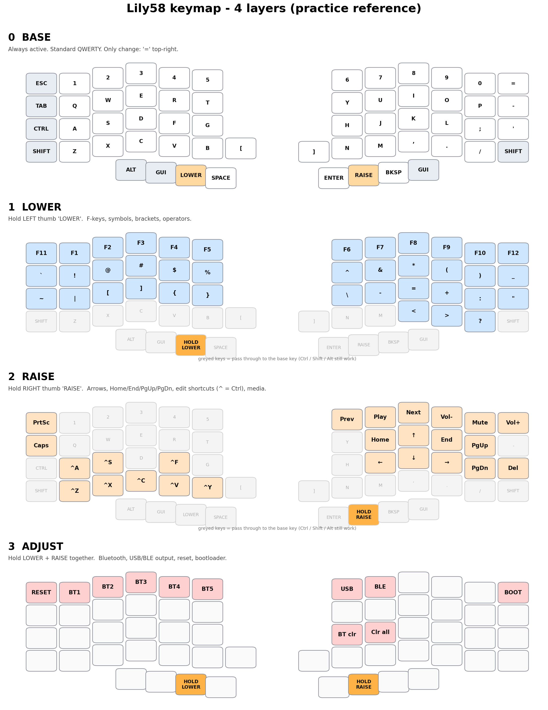

# Lily58 ZMK Keymap

A simple, standard 4-layer keymap for a Lily58 (58 keys, hand-wired, SuperMini nRF52840, ZMK firmware).

**Goals:** easy to learn coming from a traditional keyboard, good for coding, nothing that misfires.
No combos, no home-row mods, no timing tricks. Every key does one predictable thing.

Files:

| File | What it is |
| --- | --- |
| `config/lily58_hw.keymap` | The keymap itself (flash this with your firmware build) |
| `lily58-layers.png` | Picture of all 4 layers, for practice and printing |
| `README.md` | This file |



---

## 1. The big idea

The keyboard has 58 keys, far fewer than a traditional keyboard. To reach everything, some keys change meaning while you hold a **thumb key**.

| Layer | How to get there | What it is for |
| --- | --- | --- |
| **0 Base** | Always on | Typing: letters, numbers, Space, Enter, Backspace |
| **1 Lower** | Hold the **LOWER** key (left thumb) | F-keys, symbols, brackets, operators |
| **2 Raise** | Hold the **RAISE** key (right thumb) | Arrows, Home/End/PgUp/PgDn, copy/paste/undo, media |
| **3 Adjust** | Hold **LOWER + RAISE** together | Bluetooth, USB/BLE output, reset, bootloader |

Release the thumb key and you are back on Base. Nothing is "stuck" and nothing toggles.

**Greyed keys in the image** mean "not changed on this layer". They act as on Base, so **Ctrl, Shift, Alt and GUI work on every layer**. That is what makes combos like `Ctrl + Raise + Arrow` possible.

---

## 2. Physical layout

```
 L  Left half                                   Right half
 ESC  1  2  3  4  5                         6  7  8  9  0  =
 TAB  Q  W  E  R  T                         Y  U  I  O  P  -
 SHIFT A  S  D  F  G                         H  J  K  L  ;  '
 CTRL  Z X  C  V  B  [      ]      N  M  ,  .  /  SHIFT

          Left thumbs                  Right thumbs
   ALT  GUI  LOWER  SPACE        ENTER  RAISE  BKSP  GUI
   (outer)         (inner)       (inner)             (outer)
```

- **Inner thumb keys** (Space and Enter) are the easiest to hit.
- The columns are staggered to match finger length.
- `[` and `]` sit on the inner keys next to B and N.

---

## 3. Layer 0: Base

Standard QWERTY, the same as every Lily58. Two keys differ from the stock layout:

- **`=` is the top-right key.** It used to be backtick. `=` is used constantly in code, so it should not need a layer. Backtick moved to Lower (see below).
- **Ctrl and Shift are swapped.** Shift is on the left home-row outer key (where Caps Lock normally is) and Ctrl is on the bottom row below it.

Where the non-letter keys live:

| Key | Position |
| --- | --- |
| Esc | Top-left |
| Tab | Left, row 2 |
| Shift | Left, home row, outer key (where Caps Lock normally is), plus the bottom outer key on the right |
| Ctrl | Left, bottom row, outer key (below Shift) |
| Space | Left inner thumb |
| Enter | Right inner thumb |
| Backspace | Right thumb, third key |
| Alt | Left outer thumb |
| GUI (Win/Cmd) | One on each thumb cluster (left: second key in, right: outermost) |
| `-` | End of the Q row (right) |
| `=` | End of the number row (right) |
| `[` `]` | Inner keys on the bottom row |
| `;` `'` | Right of L on the home row |

---

## 4. Layer 1: Lower (hold left thumb)

Think of it as **"everything you would normally press Shift for, plus F-keys and brackets"**.

```
  F1  F2  F3  F4  F5  F7          F8  F9  F10 F11 F12  DEL
  `   !   @   #   $   %           ^   &   *   (   )    _
  ~   |   [   ]   {   }           \   -   =   +   :    "
                                        <   >   ?
```

| What | Where |
| --- | --- |
| **F1 to F5, F7** | Left hand number row (`Esc` through `5`) |
| **F8 to F12** | Right hand number row (`6` through `0`) |
| **Delete** | Top-right key (`=`) |
| **Shifted symbols** `! @ # $ %` and `^ & * ( )` | Directly under the number row, same columns as the digits |
| **Backtick `` ` ``** | Lower + Tab key |
| **Tilde `~`** | Lower + the left home-row key (Shift on Base) |
| **Underscore `_`** | End of the Q row (above where `-` is on Base) |
| **Brackets** `[ ]` and `{ }` | Left home row (S, D, F, G) |
| **Operators** `\ - = + :` and `"` | Right home row |
| **`< > ?`** | On the `, . /` keys |
| **`|` pipe** | Left home row, next to the tilde |

Everything coders need (`() [] {} <> = + - _ | \ : ; "`) is reachable without Shift.

---

## 5. Layer 2: Raise (hold right thumb)

Navigation with the right hand, edit shortcuts with the left. The arrows use the same inverted-T shape as a traditional keyboard.

```
 PrtSc                             Prev Play Next Vol- Mute Vol+
 Caps                                   Home  ↑   End  PgUp
       ^A  ^S      ^F                   ←   ↓   →    PgDn  Del
       ^Z  ^X  ^C  ^V  ^Y
```

`^` means Ctrl.

**Right hand (navigation)**

| Key | Action |
| --- | --- |
| `I` `J` `K` `L` | Up, Left, Down, Right |
| `U` / `O` | Home / End |
| `P` / `;` | Page Up / Page Down |
| `'` | Delete |
| Top row | Previous, Play/Pause, Next, Volume down, Mute, Volume up |

**Left hand (edit shortcuts)**

| Key | Action | Same as |
| --- | --- | --- |
| `A` | Select all | Ctrl+A |
| `S` | Save | Ctrl+S |
| `F` | Find | Ctrl+F |
| `Z` | Undo | Ctrl+Z |
| `X` | Cut | Ctrl+X |
| `C` | Copy | Ctrl+C |
| `V` | Paste | Ctrl+V |
| `B` | Redo | Ctrl+Y |

**Other**

| Key | Action |
| --- | --- |
| Esc position | Print Screen |
| Tab position | Caps Lock |

### Power moves

Because Ctrl and Shift still work on this layer:

| Hold | Press | Result |
| --- | --- | --- |
| Raise + Shift | Arrow | Select text |
| Raise + Ctrl | Left / Right | Jump one word |
| Raise + Ctrl + Shift | Left / Right | Select one word |
| Raise + Ctrl | Home / End | Jump to start / end of the file |
| Raise + Shift | Z | Redo (Ctrl+Shift+Z) |

### macOS

The edit shortcuts use Ctrl. On a Mac, open `config/lily58_hw.keymap` and replace every `LC(` in the Raise layer with `LG(` so they use Cmd.

---

## 6. Layer 3: Adjust (hold Lower + Raise)

System controls. It needs both thumbs, so you cannot hit it by accident.

```
 RESET  BT1  BT2  BT3  BT4  BT5         USB  BLE              BOOT
                                        BTclr  Clr all
```

| Key | Action |
| --- | --- |
| `Esc` position | **Reset** the keyboard (restart) |
| `1` to `5` | Select Bluetooth profile 1 to 5 |
| `6` | Send keys over **USB** |
| `7` | Send keys over **Bluetooth** |
| Home row, `H` | Clear the **current** Bluetooth pairing |
| Home row, `J` | Clear **all** Bluetooth pairings |
| Top-right key | **Bootloader** mode (for flashing new firmware) |

### Using multiple devices

Each of the 5 Bluetooth profiles can remember one device. Pair a different device on each slot, then switch with Adjust + 1 to 5. For example: 1 = PC, 2 = laptop, 3 = phone, 4 = tablet.

To pair a new device:
1. Select a profile with Adjust + 1 to 5.
2. If it is already used, clear it with Adjust + `H`.
3. Put the device in Bluetooth pairing mode and connect to the keyboard.

Clearing is only on Adjust so you cannot wipe a pairing by accident.

---

## 7. Learning plan

Do not try to learn everything at once.

1. **Week 1: Base only.** Just type. Keep Space and Enter on the inner thumbs, Backspace on the third right thumb key.
2. **Week 1 to 2: add Raise.** Arrows (I J K L), Home/End, copy/paste/undo. This is the biggest day-to-day gain.
3. **Week 2 to 3: add Lower.** Start with brackets and `_` `+` `=`, then the symbol row.
4. **Later: Adjust.** You only need it for Bluetooth and flashing.

Tips:
- Keep your fingers on the home row (A S D F and J K L ;). Move the thumbs to the layer keys.
- Use the picture `lily58-layers.png` as a cheat sheet next to the keyboard.
- Accuracy first, speed will come on its own.

---

## 8. Editing and flashing

- Open `config/lily58_hw.keymap` in the [Keymap Editor](https://nickcoutsos.github.io/keymap-editor/) to change keys visually. The file uses only ZMK's standard syntax (no custom `#define` macros), so the editor can read it.
- If you edit by hand, every layer must list exactly **58 bindings**: 12 + 12 + 12 + 14 for the four rows, plus 8 thumb keys.
- Rebuild the firmware as you normally do and flash both halves. Use Adjust + top-right to enter bootloader mode.
- Layer 3 is created by the `conditional_layers` block (Lower + Raise = Adjust). Do not remove it.
